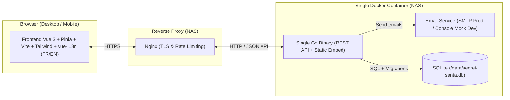
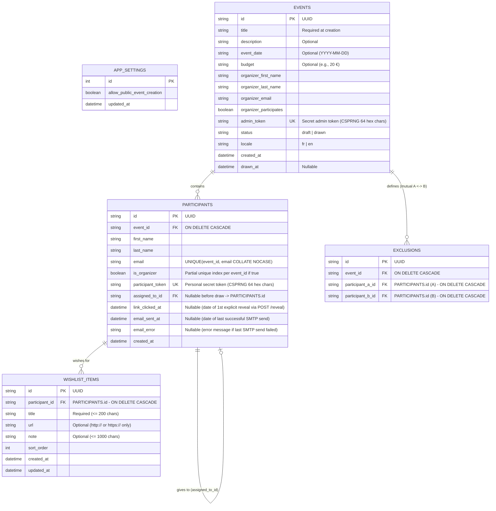
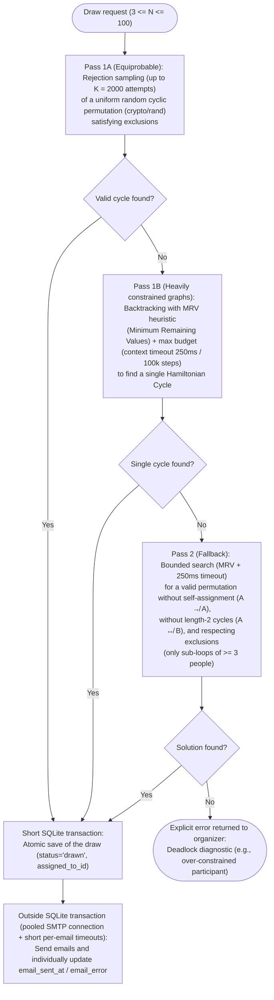

# Specification & Architecture Plan — Self-Hosted Secret Santa

An open-source **Secret Santa** web application designed for easy self-hosting on a NAS via Docker (behind a reverse proxy such as Nginx), privacy-focused, passwordless (except for the Super Administrator back-office), bilingual (French / English), and guaranteed free of dependencies on paid third-party services.

---

## 1. Technical Architecture & Stack



### Technology Choices
- **Backend**: **Go (1.22+)** — *standard library first approach (zero superfluous dependencies)*
  - Standard Go 1.22+ HTTP router `net/http.ServeMux` (with native method patterns and wildcards such as `"GET /api/p/{token}"`), without any third-party router dependency.
  - Generation of UUIDs and secret tokens (64 hexadecimal characters) directly via standard `crypto/rand` (no external dependency for identifiers).
  - Direct architecture without an intermediate service layer: handlers in `internal/api` directly call `internal/db`, `internal/draw`, and `internal/mailer`.
  - **Pure Go, CGO-free** SQLite driver (`modernc.org/sqlite`) enabling straightforward cross-compilation (`amd64` and `arm64` for all Synology, QNAP, TrueNAS, and Raspberry Pi NAS models) and a minimalist final container (`alpine` or `distroless`).
  - Compiled frontend build embedded directly into the Go binary via `embed.FS` (exposed by `web/embed.go`), with SPA fallback to `index.html` only for non-API routes (`!/api/*`) without a static asset file extension.
  - No built-in application-level rate limiting (delegated to the front-facing Nginx reverse proxy).
  - Global HTTP security headers: `Referrer-Policy: no-referrer` (prevents any leakage of URL tokens to external merchant websites linked in wishlists), `X-Content-Type-Options: nosniff`, `X-Frame-Options: DENY`.
- **Database**: **SQLite**
  - Stored in a single file mounted on a persistent Docker volume on the NAS local disk (`/data/secret-santa.db`) to survive container restarts and updates.
  - Typed SQL queries directly via standard `database/sql` (without an ORM or external migration library: idempotent `CREATE TABLE IF NOT EXISTS` schema executed on startup).
  - Strict configuration to avoid any `SQLITE_BUSY` errors: Go connection pool configured with `db.SetMaxOpenConns(1)` and pragmas passed in the DSN: `_pragma=busy_timeout(5000)&_pragma=journal_mode(WAL)&_pragma=foreign_keys(1)&_pragma=synchronous(NORMAL)`.
- **Frontend**: **Vue.js 3** (Composition API, `<script setup>`, TypeScript) + **Pinia** (centralized domain state management) + **Vite** + **Tailwind CSS** + **Vue Router** + **vue-i18n** (French by default + English).
  - **Mobile-First** approach: stacked card layout on mobile (`< 768px`), touch targets $\ge 44\times44\text{px}$, accessible native `<dialog>` modals.
- **Emails & Network Configuration**:
  - Mandatory `APP_BASE_URL` variable (e.g., `https://santa.mydomain.com`) to generate reliable absolute magic links behind Nginx without relying on the HTTP `Host` header.
  - **In Production (`APP_ENV=production`)**: Sent via standard SMTP protocol supporting all 3 TLS modes (`SMTP_TLS_MODE=starttls|tls|none` for ports 587, 465, or 25).
  - **In Development (`APP_ENV=development`)**: **No email is ever sent over the network**. All emails are intercepted by a `MockMailer` that clearly prints them to the console (with clickable magic links) and keeps them in memory for tests.
- **Authentication**:
  - **Zero password** for organizers and participants: authentication exclusively via secret magic links (`admin_token` and `participant_token`).
  - **Super Administrator only**: email/password authentication (`SUPER_ADMIN_EMAIL` / `SUPER_ADMIN_PASSWORD` defined in `.env`).

---

## 2. Data Model (SQLite)

> [!IMPORTANT]
> **Privacy by Design**:
> 1. No API endpoint intended for the event administrator or Super Administrator returns or exposes the `assigned_to_id` field from the `participants` table. Distinct Go DTO structs per role (`AdminParticipantDTO`, `ParticipantSelfDTO`, `SuperAdminEventDTO`) guarantee via static typing that no sensitive field can leak during JSON serialization.
> 2. Only a participant's individual endpoint (authenticated by their unique `participant_token`) reveals their target's first/last name and wishlist, **and only after explicit revelation (`link_clicked_at IS NOT NULL`)**. Until `POST /api/p/:participantToken/reveal` has been called, `GET /api/p/:participantToken` strictly omits the target's identity and wishlist from the returned JSON.
> 3. The `admin_token` and `participant_token` tokens are generated via `crypto/rand` (32 bytes / 64 hexadecimal characters) and stored as-is in the local SQLite database so existing links can be resent via email without invalidating previously received emails (except when a participant's email address is changed post-draw, which triggers a rotation of their `participant_token`).



### SQLite Integrity Constraints:
- `PARTICIPANTS`: `UNIQUE(event_id, email COLLATE NOCASE)` and partial unique index `CREATE UNIQUE INDEX idx_event_organizer ON participants(event_id) WHERE is_organizer = 1`.
- `EXCLUSIONS`: All exclusions are **mutual** ($A \nleftrightarrow B$). To prevent symmetric duplicates in the database, identifiers are ordered upon insertion (`participant_a_id < participant_b_id`) with `CHECK (participant_a_id < participant_b_id)` and `UNIQUE(event_id, participant_a_id, participant_b_id)`.

---

## 3. Draw Algorithm

*(Note: There is no standard or maintained Go library for uniform sampling of constrained Hamiltonian cycles with $\ge 3$ sub-cycle fallback. The algorithm below combines perfectly uniform rejection sampling with a bounded backtracking solver in ~120 lines of standard Go).*

The draw takes as input $N$ participants ($3 \le N \le 100$) and a set of mutual exclusions $E = \{ (A \nleftrightarrow B) \}$.



### Mathematical and Operational Guarantees of the Algorithm:
1. **True Equiprobability (Pass 1A) & Resilience to Dense Graphs (Pass 1B)**:
   - For virtually all real-world events, **Pass 1A** directly draws a Hamiltonian cycle via uniform random permutation (`crypto/rand`) and checks exclusions: all valid chains have **the exact same mathematical probability** of being selected.
   - If exclusions are too dense for rejection sampling after $K=2000$ attempts, **Pass 1B** uses backtracking guided by the **MRV (Minimum Remaining Values)** heuristic (participants with the fewest possible targets are processed first, with candidates randomly shuffled) within a strict budget (`250ms` max), guaranteeing zero CPU lockup (DoS) on the NAS.
2. **Priority 1 — Single Chain (Hamiltonian Cycle)**: All participants form a single closed loop $P_1 \to P_2 \to \dots \to P_N \to P_1$. As soon as $N \ge 3$, a Hamiltonian cycle automatically guarantees that no reciprocal pair ($A \leftrightarrow B$) exists.
3. **Priority 2 — Non-Reciprocal $\ge 3$ Sub-Loops Fallback**: If and only if exclusions make a single cycle impossible (e.g., two groups of 3 people completely excluded from each other), the algorithm searches for a valid derangement where every sub-cycle has size $\ge 3$ (no $A \to A$ and no $A \leftrightarrow B$) while respecting 100% of exclusions.
4. **Detected Impossibility with Clear Diagnostic**: If no solution exists even in Pass 2, the draw is rejected with an explicit message pinpointing the issue (e.g., which participant has too many exclusions).
5. **Decoupled SQLite Transaction / SMTP Sending & Timeout Protection**: The draw is first committed to the SQLite database in a few milliseconds. Emails are then sent outside the SQLite transaction by reusing a single SMTP connection for the batch (or via bounded sending with a strict `5s` timeout per email so as never to exceed Nginx's `proxy_read_timeout`), updating `email_sent_at` (or `email_error`) individually for each participant. An SMTP failure or slowness for one participant neither corrupts nor cancels the draw for the others.

---

## 4. Exhaustive List of Features & User Stories

### Epic 1: Home, Internationalization (FR/EN) & Event Initialization

- **US-1.1 — Language Switching (FR / EN)**
  - *As a* visitor, organizer, or participant,
  - *I want* to switch the interface between French and English at any time (and have the active language at event creation saved for that event's emails),
  - *So that* I can use the application in my preferred language.
  - **Acceptance Criteria**: FR/EN selector in the header; initial detection via `localStorage` then browser language (fallback `fr`); emails generated in the event's `locale`.

- **US-1.2 — Passwordless Event Creation (when public creation is enabled)**
  - *As a* visitor on the home page,
  - *I want* to enter the **Event Title**, my **First Name**, my **Last Name**, and my **Email** in a lightweight initialization form,
  - *So that* I can create my event immediately and receive my administration magic link via email.
  - **Acceptance Criteria**: Validation of email format and required fields (Title, First Name, Last Name, Email); creation of an event in `draft` status (with `organizer_participates = true` by default, pre-adding the organizer as a participant); immediate sending of an email containing the secret link `/admin/events/:adminToken`.

- **US-1.3 — Home Page When Public Creation is Disabled**
  - *As a* visitor on the home page when the Super Admin has disabled public creation,
  - *I want* to see a clear message indicating that event creation is restricted on this instance (while retaining access to the link recovery form),
  - *So that* I understand why the creation form is unavailable.
  - **Acceptance Criteria**: Public creation form is hidden and `POST /api/events` returns `403 Forbidden`.

- **US-1.4 — Unified Recovery of Lost Links (Organizer & Participant)**
  - *As an* organizer or participant who lost my email,
  - *I want* to enter my email address in the "Receive my active links" section on the home page,
  - *So that* I receive a summary email containing my administration links (events I organize) and my participation links (drawn events in which I participate).
  - **Acceptance Criteria**: Case-insensitive search across `events.organizer_email` and `participants.email` (for `drawn` events); the API always returns the same generic message ("If an event is associated with this address, an email has been sent") to preserve privacy.

---

### Epic 2: Event Administration (Draft / Preparation Mode)

- **US-2.1 — Event Dashboard Access via Magic Link**
  - *As an* event organizer,
  - *I want* to access my event management simply by clicking my secret link `/admin/events/:adminToken`,
  - *So that* I can configure my Secret Santa without a password.
  - **Acceptance Criteria**: If the token is valid, display the administration interface with a convenient "Copy my administration link" button; otherwise display a clean 404 page.

- **US-2.2 — Event Information Configuration & Organizer Participation**
  - *As an* organizer of a `draft` event,
  - *I want* to set or edit the **Title** (required), **Event Date** (optional), **Suggested Budget** (optional), **Description / Custom Message** (optional), and check or uncheck the **"I am participating in the event"** box,
  - *So that* I can customize the event and automatically include (or exclude) myself in the participant list.
  - **Acceptance Criteria**:
    - Checking "I am participating" automatically adds/synchronizes the organizer (`is_organizer = true`) in the participant list (if a participant with the same email already existed, they are promoted to `is_organizer = true`).
    - Unchecking "I am participating" removes the organizer's participant row along with their associated exclusions.
    - Any modification to the organizer's participant row (`is_organizer = true`) automatically synchronizes `organizer_first_name`, `organizer_last_name`, and `organizer_email` on the `events` table within the same transaction.
    - The organizer's row in the participant list displays an "Organizer" badge.

- **US-2.3 — Participant List Management (Add, Edit, Delete)**
  - *As an* organizer of a draft event,
  - *I want* to add participants (First Name, Last Name, Email), edit their information, or remove them with fast keyboard entry,
  - *So that* I can build the complete list of people taking part in the Secret Santa (up to 100 participants).
  - **Acceptance Criteria**:
    - Email address uniqueness within the same event (case-insensitive, normalized to lowercase).
    - Email format validation and `autocomplete="off"` on add fields; focus automatically returned to the "First Name" field after each addition.
    - If the edited participant has `is_organizer = true`, their new details (`first_name`, `last_name`, `email`) also update `events.organizer_*`.
    - Cascading deletion of exclusions linked to the deleted participant; if the organizer deletes their own participant row, the "I am participating" checkbox is automatically unchecked.

- **US-2.4 — Mutual Exclusions Management ($A \nleftrightarrow B$)**
  - *As an* organizer of a draft event,
  - *I want* to add or remove mutual exclusion rules ("A and B cannot draw each other"),
  - *So that* partners or two people who exchanged gifts last year do not draw each other.
  - **Acceptance Criteria**: "Participant A" $\nleftrightarrow$ "Participant B" selector; prevents selecting the same person twice ($A \nleftrightarrow A$) or an already excluded pair (regardless of $A\text{-}B$ or $B\text{-}A$ order); clear display of excluded pairs with one-click deletion.

- **US-2.5 — Dry-Run Draw Feasibility Check**
  - *As an* organizer configuring exclusions,
  - *I want* to see in real time whether my current exclusions allow a single chain, require $\ge 3$ sub-loops, or mathematically block the draw,
  - *So that* I can fix my exclusions immediately without unpleasant surprises.
  - **Acceptance Criteria**: Visual indicator updated automatically (as soon as $N \ge 3$) showing:
    - "Valid draw (Single chain)",
    - "Valid draw (Sub-loops of 3+ people)",
    - or "Impossible draw" with an explanation if a participant has no allowed target left.

---

### Epic 3: The Draw & Initial Email Sending

- **US-3.1 — Running the Draw and Sending Emails**
  - *As an* organizer who has finished preparing the event (with a title and at least 3 participants),
  - *I want* to click "Launch the draw and send emails" (with a confirmation modal),
  - *So that* participants are drawn at random and each receives their secret link by email.
  - **Acceptance Criteria**:
    - While there are fewer than 3 participants, the button is disabled with an explicit message indicating how many more participants are needed.
    - Automatic prior saving of any pending edits in the event details form.
    - Idempotency: atomic locking (`UPDATE events SET status = 'drawn' WHERE id = ? AND status = 'draft'`), preventing any double draw on double-click (`409 Conflict`).
    - Permanent locking of participant addition/deletion and exclusion editing.
    - Sending of a personalized email to each participant containing the event details (Title, Date, Budget, Description) and their secret link `/p/:participantToken`, reusing a single SMTP connection per batch (with a short `5s` timeout per message to avoid any `504 Gateway Timeout` behind Nginx) and individually recording `email_sent_at` (or `email_error` in case of an SMTP failure for a participant).

---

### Epic 4: Post-Draw Tracking & Management by the Event Administrator

- **US-4.1 — Tracking Dashboard Without Draw Disclosure**
  - *As an* administrator of a `drawn` event,
  - *I want* to see the list of participants with 3 clear indicators (icon + accessible text): **"Email Status"** (Sent / Failed), **"Revealed target"** (Yes + date / Pending), and **"Filled wishlist"** (Yes + item count / Empty), **without ever being able to see who drew whom**,
  - *So that* I can make sure everyone received their email, discovered their target, and prepared their wishlist without spoiling the surprise.
  - **Acceptance Criteria**: No draw assignment data (`assigned_to_id`) is included in the administration API JSON response; displays a global "Resend failed emails" button if at least one participant has `email_sent_at IS NULL`.

- **US-4.2 — Quick Access to the Organizer's Own Participant Page**
  - *As an* organizer participating in the event myself,
  - *I want* a "Go to my participant page" button on my administration dashboard once the draw is complete,
  - *So that* I can easily discover my own target and manage my wishlist.
  - **Acceptance Criteria**: Button displayed only if `organizer_participates == true` and `status == 'drawn'`.

- **US-4.3 — Post-Draw Flexibility: Metadata Editing, Identity/Email Correction, and Email Resending**
  - *As an* administrator of a `drawn` event,
  - *I want* to edit general event information (Title, Date, Budget, Description), fix a typo in a participant's **First Name**, **Last Name**, or **Email**, and resend their participation email in one click,
  - *So that* I can fix a data entry mistake or specify the party venue/time without altering the completed draw.
  - **Acceptance Criteria**:
    - Editing allowed in `drawn` status for the event's `title`, `event_date`, `budget`, and `description`.
    - Editing allowed in `drawn` status for an existing participant's `first_name`, `last_name`, and `email` (with format and uniqueness validation, without allowing adding/removing participants or re-running the draw). If the participant is the organizer (`is_organizer = true`), `events.organizer_*` is synchronized within the same transaction.
    - If a participant's `email` address is modified in `drawn` status, their `participant_token` is regenerated (to revoke any access mistakenly sent to the old address) and their `link_clicked_at`, `email_sent_at`, and `email_error` indicators are reset to `NULL`.
    - "Resend email" button on each participant that resends their `/p/:participantToken` link and updates `email_sent_at` (and clears `email_error`).

- **US-4.4 — Manual Event Deletion by the Organizer**
  - *As an* administrator of an event (in draft or completed),
  - *I want* to permanently delete my event (via a confirmation modal),
  - *So that* all personal data (names, emails, wishlists, draw results) is erased once the party is over.
  - **Acceptance Criteria**: Cascading deletion of the event, participants, exclusions, and wishlists in the SQLite database.

---

### Epic 5: Participant Space (Target Reveal & Wishlist)

- **US-5.1 — Secret Link Access Without Email Bot False Positives or Network Leaks**
  - *As a* participant who received my email,
  - *I want* to click my secret link `/p/:participantToken` to directly access my personal space without a password,
  - *So that* I can view the event details (Title, Date, Budget, Description) and participate easily.
  - **Acceptance Criteria**: The initial `GET /api/p/:participantToken` call is strictly read-only, **does not modify** `link_clicked_at` (ensuring email/WhatsApp/iMessage/Outlook SafeLinks preview bots never mark the link as opened on behalf of the participant), and **returns neither the target's name nor wishlist** while `link_clicked_at IS NULL`.

- **US-5.2 — Interactive Target Reveal and Actual Open Tracking**
  - *As a* participant on my personal page,
  - *I want* both the name AND wishlist of the person I drew to be initially hidden behind an interactive "Discover who I drew" button,
  - *So that* someone looking at my screen cannot accidentally see the name (or guess the target from their wishlist), while confirming to the organizer that I have viewed my draw.
  - **Acceptance Criteria**:
    - Until the participant clicks "Discover", neither the target's name nor wishlist is transmitted in `GET /api/p/:participantToken` (while `link_clicked_at IS NULL`) nor rendered in the DOM (`v-if`, not just CSS blur).
    - Clicking "Discover" calls `POST /api/p/:participantToken/reveal`, which sets `link_clicked_at` (if it was `NULL`) and returns the target's name and wishlist (with the ability to locally hide/show them on screen during subsequent visits).

- **US-5.3 — Clear Visual Separation & Viewing the Target's Wishlist**
  - *As a* Secret Santa who has revealed my target,
  - *I want* to clearly see two distinct sections: **1) "My Secret Santa Mission"** (the person I am gifting to and their gift ideas list) and **2) "My Wishlist"** (what I would like to receive),
  - *So that* I never confuse my target's wishlist with my own.
  - **Acceptance Criteria**: Displays the target's wishlist (or a friendly empty state if they haven't added any ideas yet); opens URL links in a new tab (`target="_blank" rel="noopener noreferrer"`); active `Referrer-Policy: no-referrer` header.

- **US-5.4 — Managing One's Own Wishlist (CRUD)**
  - *As a* participant on my personal page,
  - *I want* to add, edit, and delete gift ideas in my own wishlist (**Title/Idea** required, **URL Link** optional, **Note/Comment** optional),
  - *So that* I can help the person who drew me choose a gift I will enjoy, without any automatic email being sent to them.
  - **Acceptance Criteria**:
    - Explicit reassuring note: *"Visible only to your Secret Santa. No email is sent when you update your list."*
    - If a URL is entered without a protocol (e.g., `amazon.com/dp/...`), automatically prefix it with `https://`; strict backend validation allowing only `http://` and `https://` schemes (rejecting any `javascript:` or `data:`).
    - Immediate update of the "Filled wishlist" indicator visible to the event administrator.

---

### Epic 6: Super Administrator Back-Office

- **US-6.1 — Super Administrator Authentication (Only Password-Protected Access)**
  - *As the* NAS owner (Super Administrator),
  - *I want* to log in to `/superadmin` using the credentials defined in my environment variables (`SUPER_ADMIN_EMAIL` / `SUPER_ADMIN_PASSWORD`),
  - *So that* I can securely manage my Secret Santa instance.
  - **Acceptance Criteria**: Authentication via a signed `HttpOnly; SameSite=Strict` cookie (with the `Secure` attribute enabled whenever `APP_BASE_URL` uses `https://` or `APP_ENV=production`); constant-time comparison of SHA-256 digests (`crypto/subtle.ConstantTimeCompare` over `sha256.Sum256`) so neither the content nor the length of the password is leaked.

- **US-6.2 — Enabling / Disabling Public Event Creation**
  - *As a* Super Administrator,
  - *I want* to enable or disable public event creation from the home page at any time via a toggle switch,
  - *So that* I can choose whether my instance is open for self-service to friends and family or locked down to invitation-only.
  - **Acceptance Criteria**: Setting persisted in the `app_settings` table in SQLite and applied immediately.

- **US-6.3 — Inviting an Organizer by Email (Even When Public Creation is Disabled)**
  - *As a* Super Administrator,
  - *I want* to enter an Event Title, First Name, Last Name, and Email for a person in the back-office to create an event for them and email them their administration link,
  - *So that* I can allow a friend or relative to organize a Secret Santa even when public creation is disabled.
  - **Acceptance Criteria**: Creates an event in `draft` status for that organizer and immediately sends their administration magic link via email.

- **US-6.4 — Global Events View, SMTP Test, Organizer Link Resend, and Deletion**
  - *As a* Super Administrator,
  - *I want* to see the list of all events hosted on the instance (Title, Organizer Name and Email, Creation Date, Draft/Drawn Status, Participant Count, Revealed Targets Count, Filled Wishlists Count), be able to **test my SMTP configuration in 1 click**, **resend the administration link to the organizer**, and **delete an event**, **without ever seeing who drew whom**,
  - *So that* I can monitor and maintain my instance while respecting the secrecy of the draws.
  - **Acceptance Criteria**: Complete summary table/cards; "Send test email to Super Admin" button; "Resend admin link" button; "Delete event" button with confirmation.

---

### Epic 7: Email System, Security & Self-Hosting (Docker / NAS)

- **US-7.1 — Strict Email Simulation in Development (`APP_ENV=development`)**
  - *As a* developer,
  - *I want* an absolute guarantee that no real email is sent when `APP_ENV=development` (only printed in terminal logs with clickable links),
  - *So that* I can test freely with any email addresses without risking accidental delivery.
  - **Acceptance Criteria**: In `development` mode, the `Mailer` exclusively uses the `ConsoleMockMailer` implementation (no SMTP network connection is opened, even if `SMTP_*` variables are present).

- **US-7.2 — Docker Deployment & SQLite Persistence on NAS**
  - *As a* NAS user,
  - *I want* to deploy the application via a simple `docker compose up -d` with a `.env` file and a persistent volume mounted on `/data`,
  - *So that* my events and wishlists are preserved across container restarts or updates.
  - **Acceptance Criteria**: Functional multi-stage `Dockerfile`, documented `docker-compose.yml`, complete `.env.example` (`APP_BASE_URL`, `SMTP_TLS_MODE`, etc.), SQLite migrations applied automatically on Go binary startup.

---

## 5. Project Structure

```text
secret-santa-agy/
├── cmd/
│   └── server/
│       └── main.go                 # Go entrypoint, wiring, and HTTP server startup
├── internal/
│   ├── config/
│   │   └── config.go               # Reading and validating configuration (.env, APP_BASE_URL, SMTP_TLS_MODE)
│   ├── db/
│   │   ├── sqlite.go               # SQLite connection (MaxOpenConns(1), WAL, busy_timeout, Foreign Keys) & migrations
│   │   └── repository.go           # Typed SQL queries and short transactions
│   ├── draw/
│   │   ├── solver.go               # Uniform sampling (Pass 1A) + Bounded MRV Backtracking (Pass 1B & Pass 2)
│   │   └── solver_test.go          # Intensive unit tests (cycles, mutual exclusions, equiprobability, timeouts)
│   ├── mailer/
│   │   ├── mailer.go               # Mailer interface + FR/EN email templates
│   │   ├── smtp.go                 # SMTP implementation (STARTTLS / Implicit TLS / None — prod only)
│   │   ├── mock.go                 # Simulation/Console implementation (dev & tests)
│   │   └── mailer_test.go          # Tests guaranteeing non-sending in dev and FR/EN rendering
│   └── api/
│       ├── dto.go                  # Strict role-based DTO structs (zero leak guarantee for assigned_to_id)
│       ├── router.go               # HTTP routes, security headers (Referrer-Policy: no-referrer) & SPA fallback
│       ├── handlers_public.go      # Public status, event creation, unified link recovery
│       ├── handlers_event_admin.go # Event management, participants, mutual exclusions, draw, post-draw editing
│       ├── handlers_participant.go # Participant space (read-only GET, POST /reveal), wishlist CRUD
│       ├── handlers_superadmin.go  # Super Admin login, public creation toggle, SMTP test, list/invite/delete
│       └── api_test.go             # End-to-end integration tests for all endpoints and User Stories
├── web/                            # Frontend Vue 3 + Pinia + TypeScript + Vite + Tailwind CSS
│   ├── embed.go                    # //go:embed all:dist for clean export to cmd/server
│   ├── src/
│   │   ├── i18n/                   # Translation dictionaries fr.json and en.json
│   │   ├── stores/                 # Pinia stores (eventAdmin, participant, superAdmin, appConfig)
│   │   ├── router/                 # Vue Router routes (/, /admin/events/:token, /p/:token, /superadmin)
│   │   ├── views/                  # HomeView, EventAdminView, ParticipantView, SuperAdminView
│   │   ├── components/             # Reusable UI components (LangSwitcher, DialogModal, etc.)
│   │   └── __tests__/              # Pinia store & Frontend component tests (Vitest + Vue Test Utils)
│   ├── package.json
│   └── vite.config.ts
├── Dockerfile                      # Multi-stage build (Node -> Go -> Alpine)
├── docker-compose.yml              # Turnkey deployment with persistent SQLite volume
├── .env.example                    # Documented configuration example
└── README.md                       # Complete installation documentation (Nginx, NAS, SQLite backups)
```

---

## 6. Exhaustive Testing Strategy

Every feature and User Story will be covered by automated tests:

1. **Draw Algorithm Unit Tests (`internal/draw/solver_test.go`)**:
   - Verify that a draw without exclusions for $N \in \{3, 4, 5, 10, 50\}$ consistently produces a **single Hamiltonian cycle** ($1$ single loop of size $N$) and no reciprocal pairs ($A \leftrightarrow B$).
   - **Statistical equiprobability test**: on $N = 4$ (6 possible directed Hamiltonian cycles), verify over 6,000 draws that each cycle appears uniformly ($\sim 1000 \pm 15\%$).
   - Verify strict compliance with mutual exclusions ($A \nleftrightarrow B$).
   - Verify **$\ge 3$ sub-loops fallback (Pass 2)**: create a 6-person graph split into two groups of 3 by inter-group mutual exclusions where a single 6-person Hamiltonian cycle is impossible, but two 3-person loops exist $\rightarrow$ the algorithm properly finds the two 3-person loops without any reciprocal pair ($A \leftrightarrow B$).
   - Verify mathematically impossible cases:
     - 3 people with one mutual exclusion $\rightarrow$ `ErrNoValidDraw`.
     - 4 people where the only solution is two 2-cycles ($A \leftrightarrow B$ and $C \leftrightarrow D$) $\rightarrow$ rejected (`ErrNoValidDraw`).
     - 5 people where a 5-cycle is impossible (since $5$ cannot be partitioned into integers $\ge 3$) $\rightarrow$ rejected (`ErrNoValidDraw`).
   - **Anti-DoS performance test**: heavily constrained and unsatisfiable $N = 50$ graph $\rightarrow$ returns `ErrNoValidDraw` in under `600ms`.

2. **Email System Unit Tests (`internal/mailer/mailer_test.go`)**:
   - Guarantee that in `APP_ENV=development` mode, the `NewMailer()` factory always instantiates the `MockMailer` and opens no network connection.
   - Verify rendering of email templates in French (`fr`) and English (`en`) with `APP_BASE_URL` (magic links, title, budget, date).

3. **End-to-End Backend Integration Tests (`internal/api/api_test.go`)**:
   - Run against a real in-memory SQLite database with `MockMailer` to verify each User Story:
     - Public event creation with Title (enabled vs. disabled by Super Admin).
     - Unified link recovery (returns both organizer and participant links associated with an email).
     - Organizer invitation by the Super Admin when public creation is disabled, and Super Admin SMTP test.
     - Event configuration, "I am participating" checkbox synchronization, adding/removing participants, mutual exclusions ($A \nleftrightarrow B$).
     - Draw execution, double-click protection (`409 Conflict`), partial SMTP failure tolerance (`email_sent_at` / `email_error`), and **strict verification that event admin and Super Admin JSON responses never contain the drawn target's ID or name**.
     - Verify that `GET /api/p/:token` **does not modify** `link_clicked_at` and **exposes neither the target's name nor wishlist** while `link_clicked_at IS NULL`, and that only `POST /api/p/:token/reveal` sets `link_clicked_at` and reveals the target and their wishlist.
     - Adding/editing/deleting wishlist items (automatic `https://` prefixing, rejection of `javascript:alert(1)` with `400 Bad Request`) $\rightarrow$ updates the "Filled wishlist" status on the admin side and is visible only to the Secret Santa who revealed their target.
     - Post-draw flexibility: editing the event's Title/Date/Budget/Description and correcting a participant's First Name/Last Name/Email (with synchronization of `events.organizer_*` if `is_organizer = true`, and rotation of `participant_token` + resetting `link_clicked_at`/`email_sent_at`/`email_error` to `NULL` if the email changes) + resending their individual email.
     - Verification of the `Referrer-Policy: no-referrer` header and cascading event deletion.

4. **Frontend Pinia Stores and Component Unit Tests (`web/src/__tests__/`)**:
   - Tests using **Vitest**, **@pinia/testing**, and **@vue/test-utils** covering Pinia stores and main views, FR/EN language switching, absence of the target's name and wishlist from the DOM before clicking "Discover" (`POST /reveal`), and wishlist management.

---

## 7. Step-by-Step Execution Plan

1. **Step 1 — Go Backend Initialization & SQLite Database**: Set up the Go module (stdlib + `modernc.org/sqlite`), `.env` configuration (`APP_BASE_URL`, `SMTP_TLS_MODE`), idempotent SQLite schema (`MaxOpenConns(1)`, WAL, integrity constraints), and `repository` layer (`database/sql`).
2. **Step 2 — Draw Engine & Email System (Prod/Dev)**: Implement the draw algorithm (uniform sampling Pass 1A + bounded MRV backtracking Pass 1B & Pass 2) and email services (SMTP with pooled connection per batch + console simulation in dev) along with their unit test suites.
3. **Step 3 — Complete REST API & Go Integration Tests**: Implement all endpoints on `net/http.ServeMux` (Public, Event Admin, Participant with `/reveal`, Super Admin), direct calls to `db`/`draw`/`mailer` packages, strict DTOs, security headers, and validation through integration tests covering 100% of User Stories.
4. **Step 4 — Vue.js 3 + Pinia Frontend (FR/EN) & Vitest Tests**: Create the Mobile-First Vue 3 + Pinia + Tailwind CSS + `vue-i18n` application (Dedicated stores, Home, Organizer Dashboard, Participant Page with interactive reveal and wishlist, Super Admin Back-Office) and store/component unit tests.
5. **Step 5 — Single Binary Integration, Docker & Documentation**: Embed the Vue.js build into the Go binary (`web/embed.go`), create the `Dockerfile`, `docker-compose.yml`, `.env.example`, and `README.md` (including recommended Nginx configuration), and run the full test suites (Backend + Frontend).
